# Zaika 2.1

**Zaika** (ज़ायका, "taste") is a full-stack Indian food delivery app: a light, modern storefront with live order tracking, and a restaurant admin panel with a real-time kitchen board, all running on one Express API and Neon Postgres.

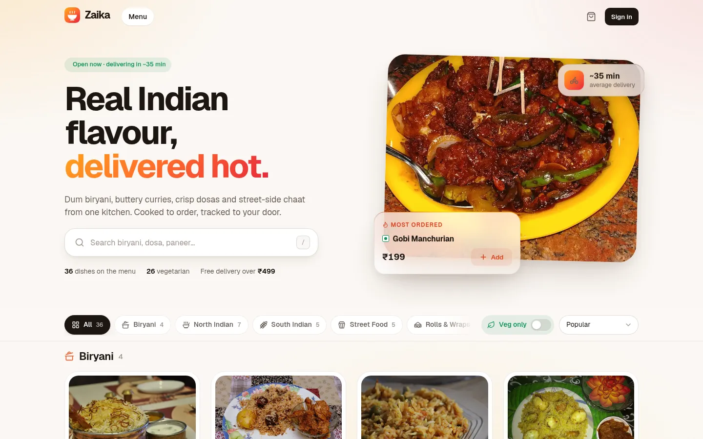

| Kitchen dashboard | Live kitchen board |
|---|---|
| 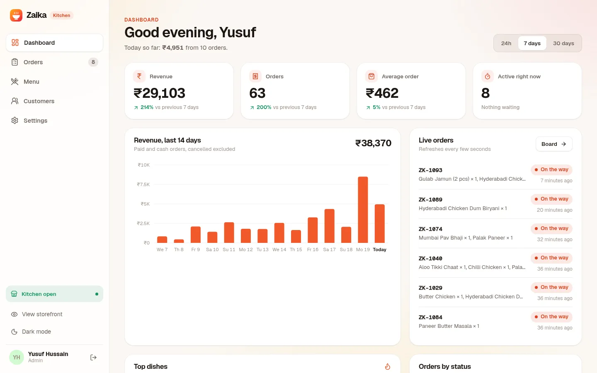 | 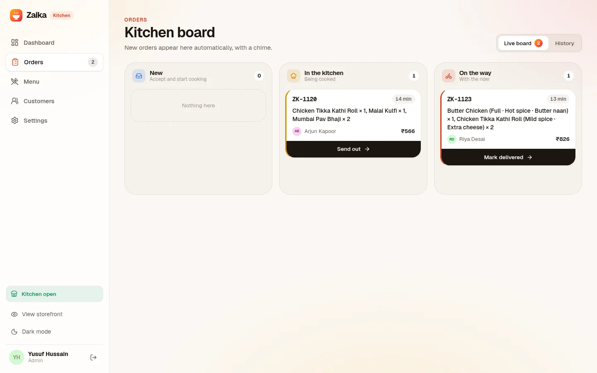 |

## What's new in 2.1

| Live delivery map | Dish customisation |
|---|---|
| 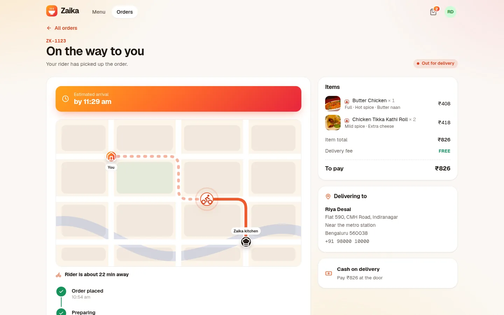 | 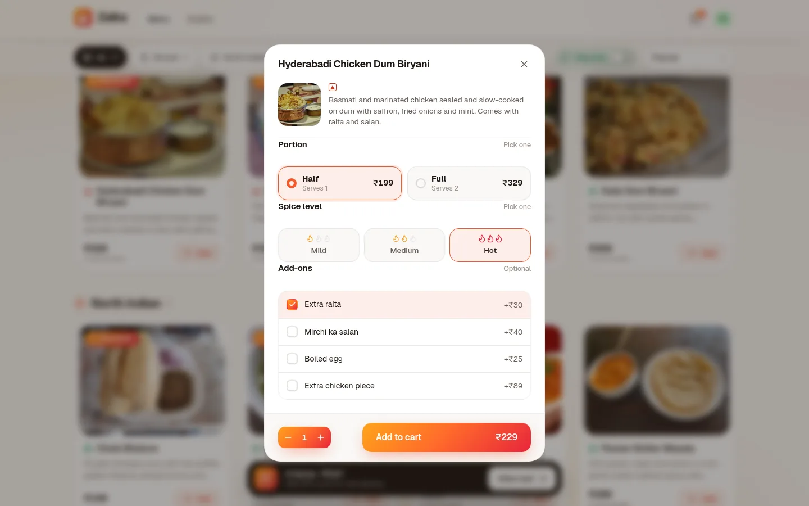 |

- **Live delivery map.** While an order is out for delivery, an illustrated map (no map API or key) shows the rider moving from the kitchen to your door, with "Rider is about X min away". The kitchen sees a mini map in the order drawer.
- **Dish customisation.** Half or full portion, mild / medium / hot, and priced add-ons (extra raita, butter naan, …) in a bottom sheet with a live total. Options show in the cart, checkout, order page and on kitchen tickets, and reorder brings them back. Prices are still computed only on the server.
- **Razorpay payments.** UPI, cards, netbanking and wallets through Razorpay Checkout, verified on the server, with automatic refunds when a paid order is cancelled.
- **"Order placed" moment.** A full-screen check-and-confetti animation that fades into tracking in 1.5 seconds (skipped with reduced motion).
- **Feels like a phone app.** A bottom tab bar on phones (Home, Search, Cart, Orders, Account), animated page changes with the View Transitions API, and an installable PWA that opens offline.
- **Fixes.** Deep links into guarded pages (like `/admin/orders?open=…`) no longer lose their query string, and refreshing an order page no longer replays the "order placed" banner.

## What's new in 2.0

- **One app, one command.** The separate customer site, admin site and API are now a single React 19 + Express 5 project. `npm run dev` serves everything on one port; Vercel serves it as a static site plus one serverless function.
- **Neon Postgres instead of MongoDB.** A cloud database you never have to start, with versioned SQL migrations.
- **A brand-new design.** Light-first 2026 look with Geist type, a saffron-to-chilli gradient, frosted glass and a warm aurora. Dark mode is an optional toggle.
- **Live order tracking.** Every status change is timestamped and the order page updates itself.
- **A real restaurant console.** Dashboard with KPIs and charts, a Kanban kitchen board with chimes for new orders, menu, customers and store settings.
- **Security fixes.** The original API let anyone add or delete dishes and change any order, trusted prices sent by the browser, and marked Stripe orders paid from a URL flag. All fixed (see [Security](#security)).
- **Demo data** with 36 Indian dishes and real photos, plus a read-only demo admin for portfolio visitors.

## Features

### For customers
- Menu grouped by category (biryani, North and South Indian, street food, rolls, Indo-Chinese, desserts, drinks) with search (press `/`), a veg-only switch and sorting
- Indian veg / non-veg marks on every dish, **Bestseller** badges calculated from real orders in the last 30 days, sold-out states
- Dish quick-view, quantity steppers, and a floating cart bar with a free-delivery nudge
- **Customisable dishes:** half / full portion, spice level and add-ons in a bottom sheet with a live total; the same dish with different options becomes separate cart lines
- Guest cart that is kept and merged into your account when you sign in
- Checkout with a saved address, inline validation (phone, 6-digit PIN code), a note for the kitchen, and **Razorpay** (UPI, cards, netbanking, wallets), cash on delivery, or card through Stripe when configured
- Order page with estimated arrival, a step-by-step timeline with real times, automatic refresh and, once the rider leaves, a **live delivery map**
- A full-screen "order placed" celebration after checkout
- On phones: a bottom tab bar, a Search tab that opens the menu search, and animated page changes; installable as an app (PWA) with an offline shell
- Order history with cancel (until the kitchen starts cooking) and one-tap reorder
- Account page for profile, default address and theme

### For the restaurant (`/admin`)
- **Dashboard:** revenue, orders, average order value and active orders, compared with the previous 24 hours / 7 / 30 days; a 14-day revenue chart with tooltips; live orders; top dishes; orders by status
- **Kitchen board:** New → In the kitchen → On the way, one-click advance, wait-time warnings, a chime and toast for every new order, searchable history
- **Order drawer:** customer details with tap-to-call, address, note, bill with each dish's options, payment state and timeline, and a mini delivery map while the rider is out; cancel with confirmation (paid online orders are refunded automatically)
- **Menu manager:** add and edit dishes with drag-and-drop photo upload and a live card preview, customer options (spice level, half portion price, up to 10 add-ons), instant sold-out switch, delete with confirmation
- **Customers:** lifetime spend ranking, repeat-customer rate, top customer
- **Store settings:** open or close the kitchen (closes checkout and shows a banner), delivery fee, free-delivery threshold and delivery time

### Under the hood
- Skeleton loaders, empty and error states, toasts, disabled and loading buttons everywhere
- Responsive from 390px phones to wide desktops, keyboard focus styles, aria labels, `prefers-reduced-motion`
- Optimistic cart and stock toggles with rollback; late server replies can't overwrite newer clicks
- Database connection retries for flaky networks

## Screenshots

| | |
|---|---|
| 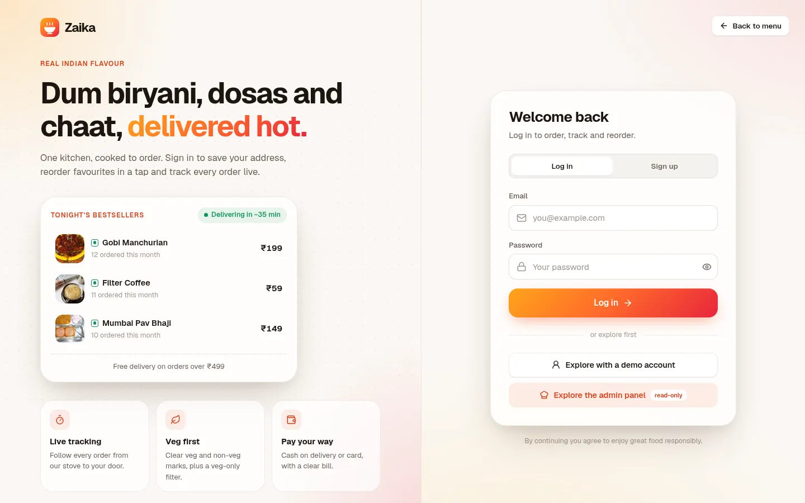 | 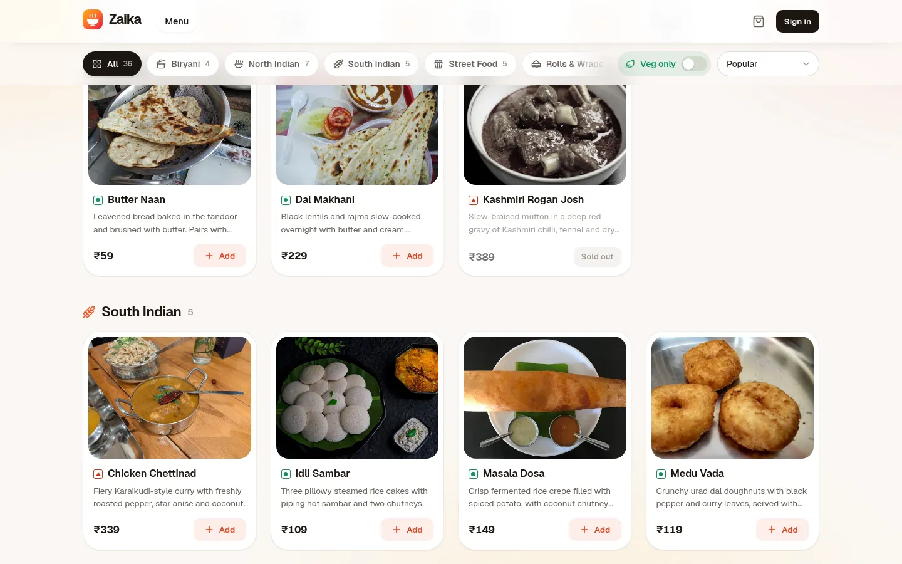 |
| 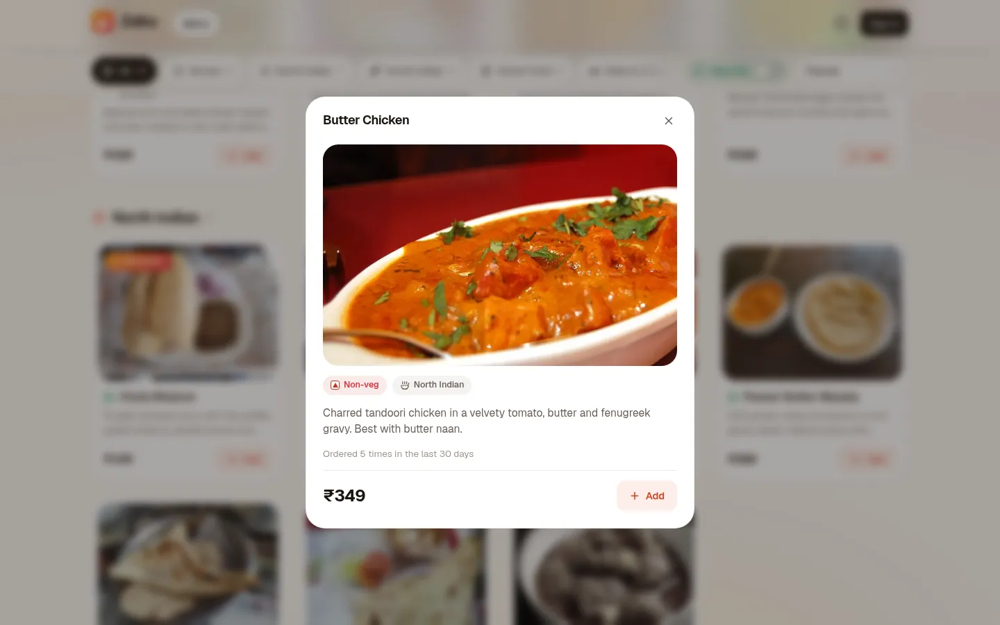 | 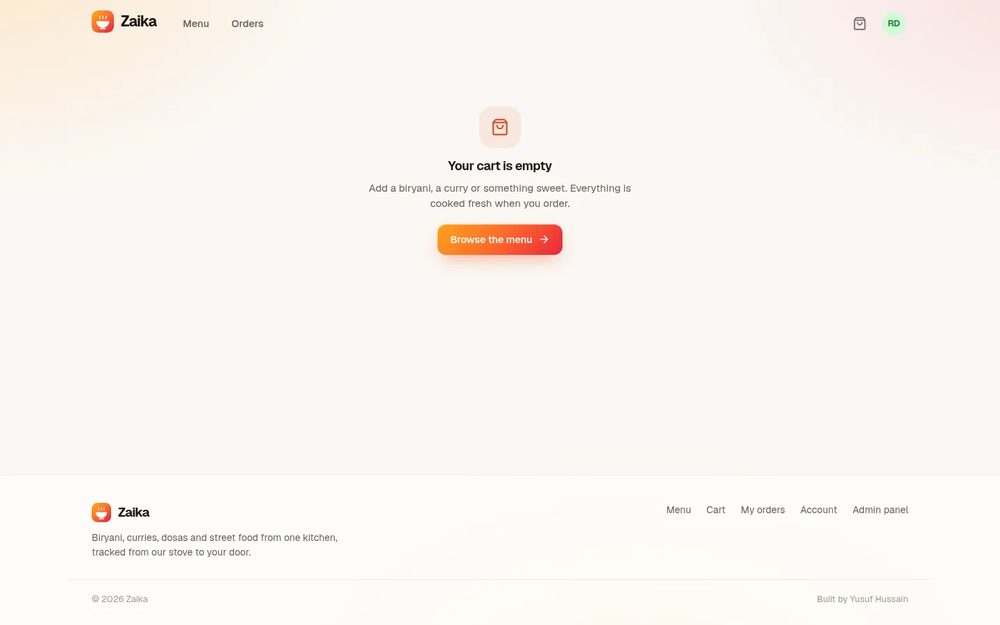 |
| 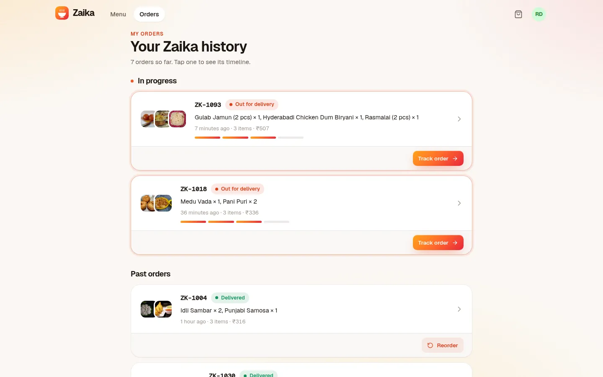 | 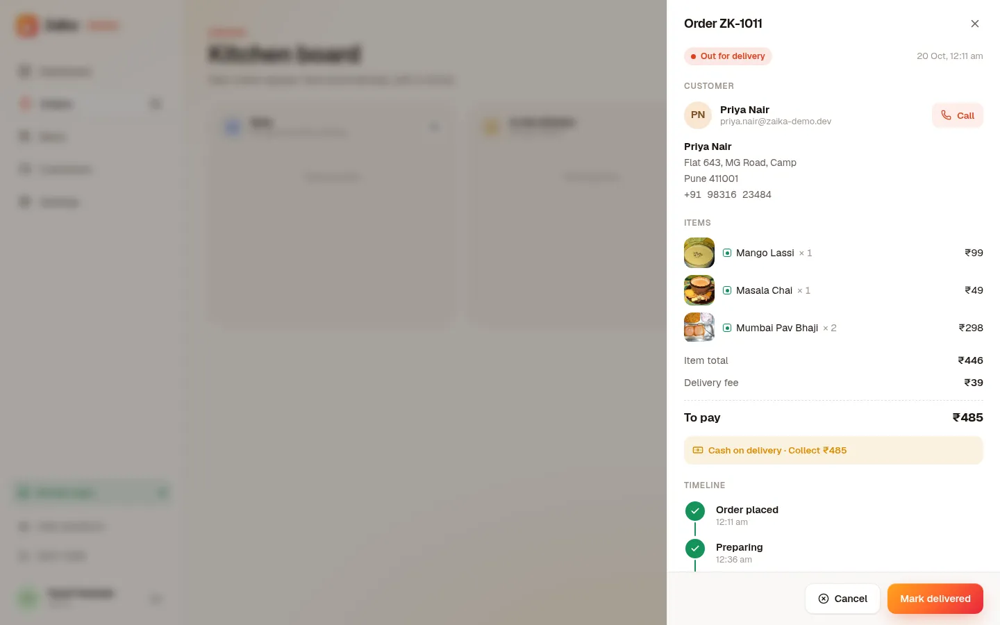 |
| 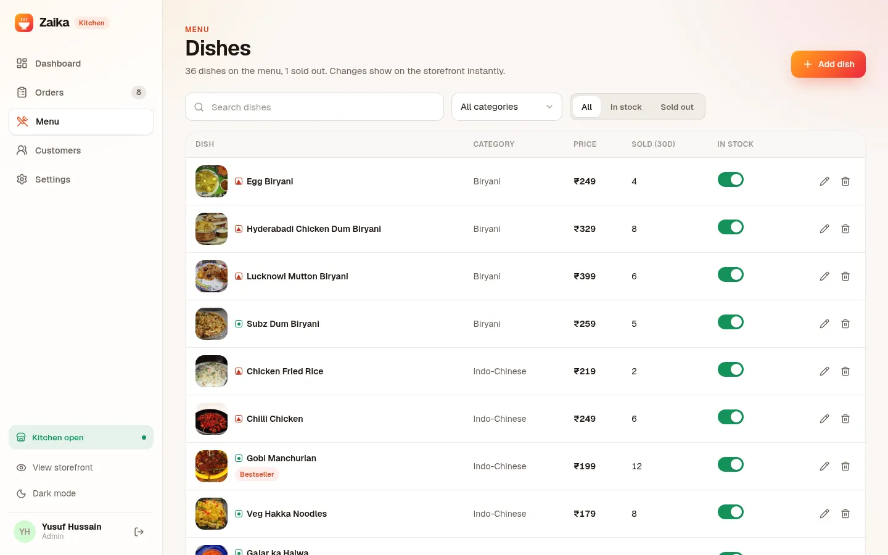 | 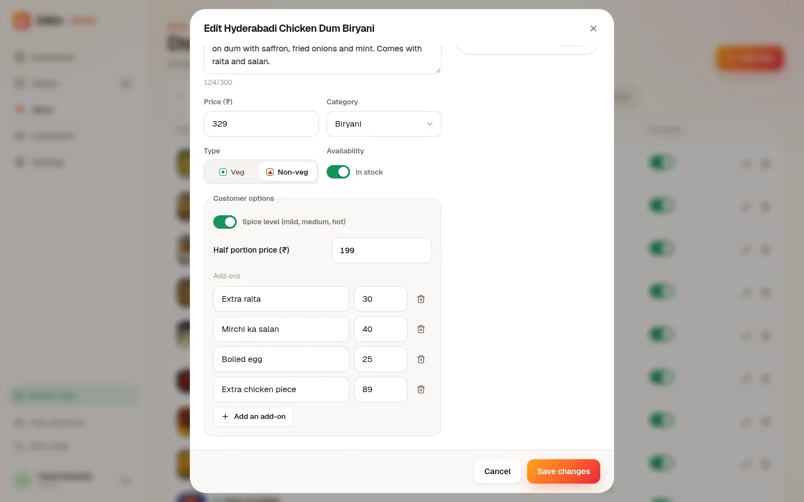 |
| 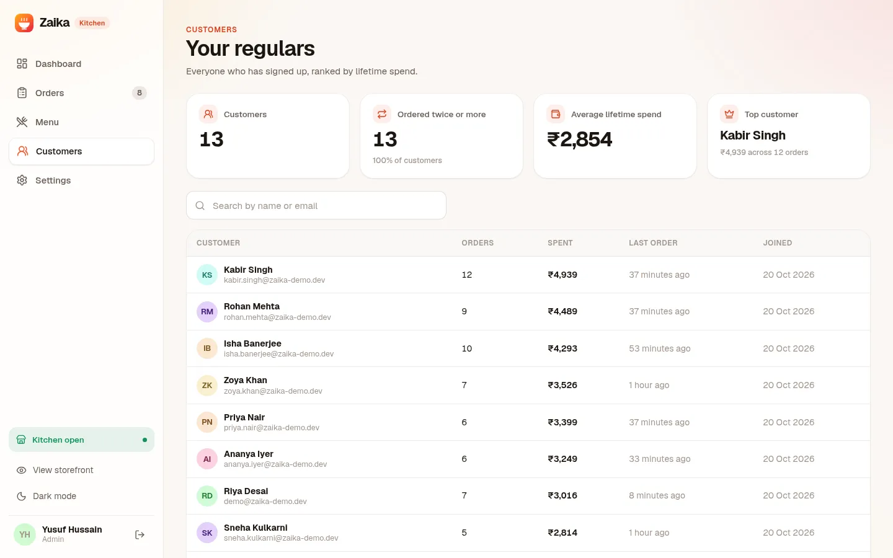 | 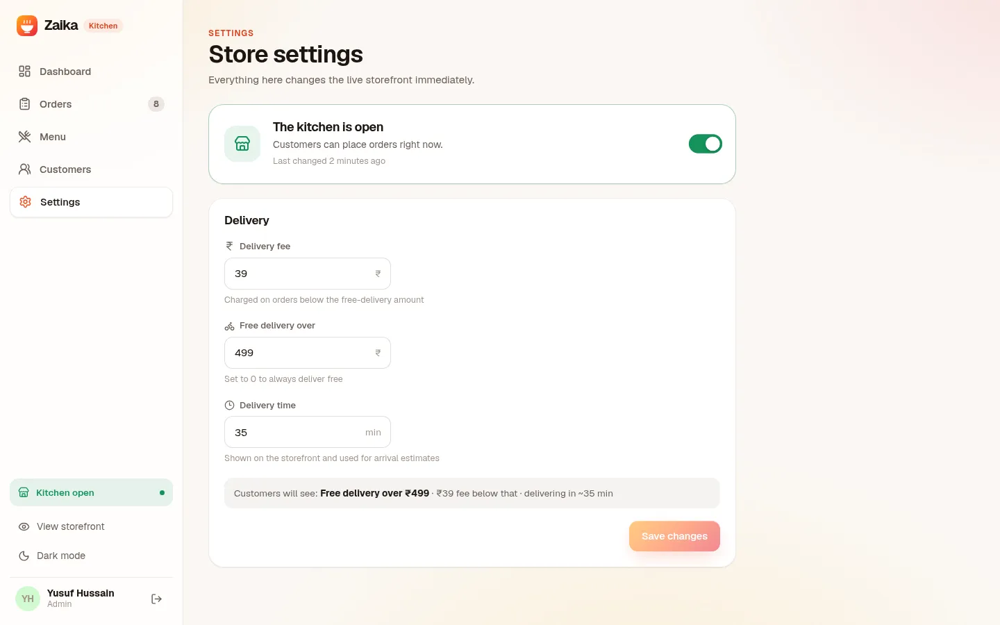 |
| 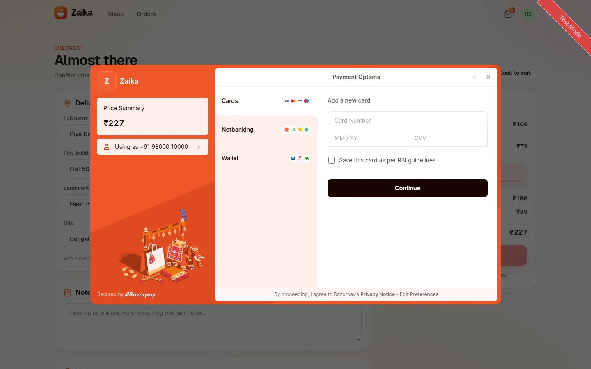 | 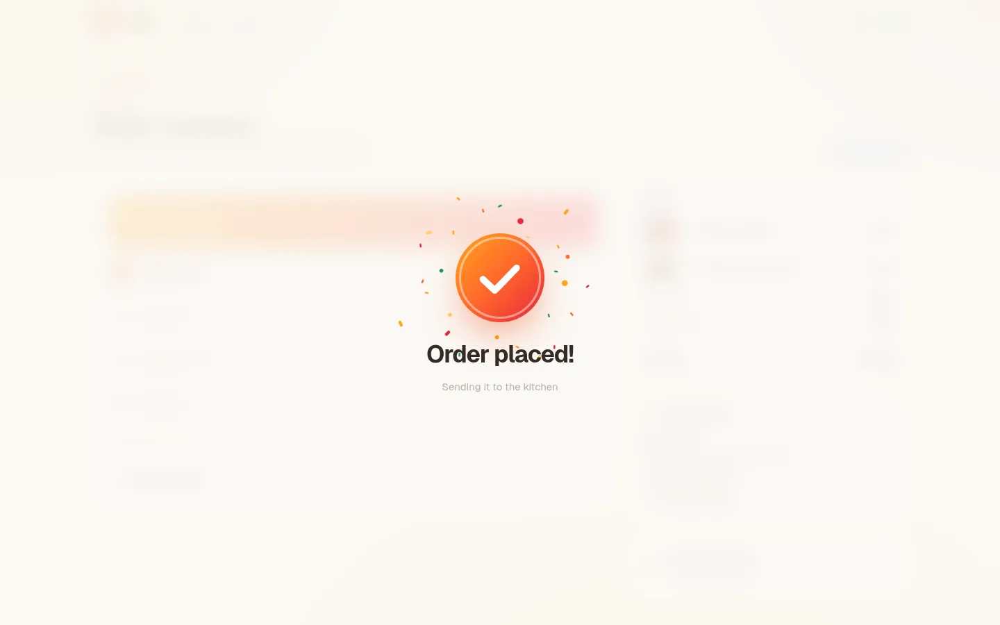 |

| Phone | Customise | Order tracking | Dark mode |
|---|---|---|---|
| 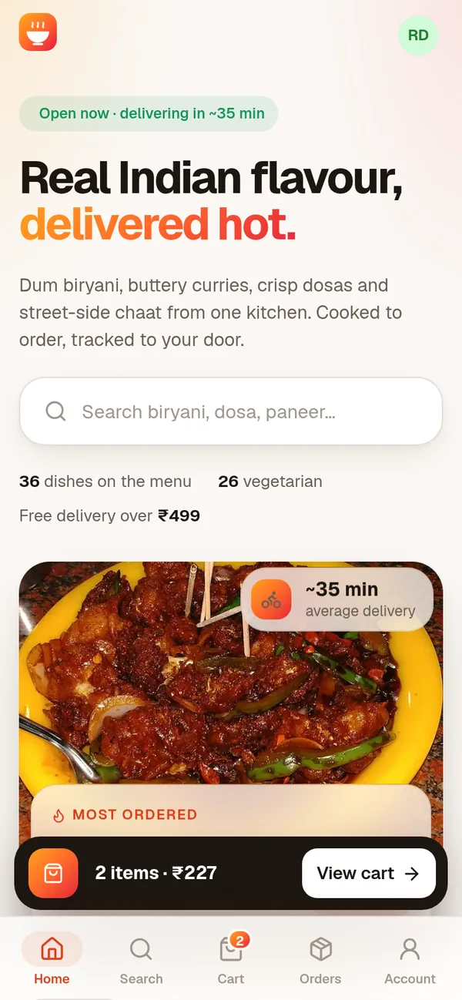 | 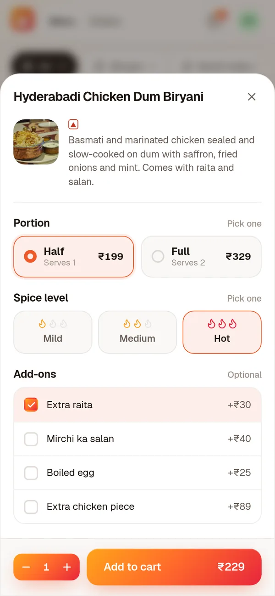 | 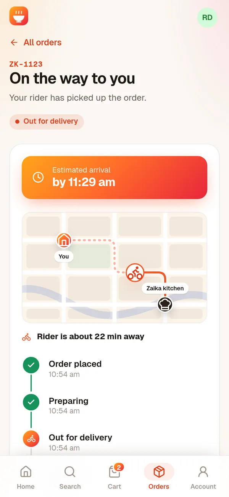 | 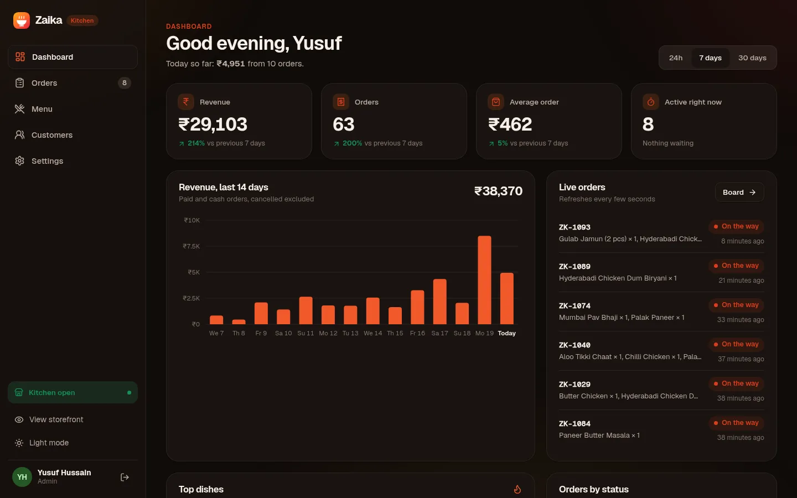 |

## Tech stack

| Layer | Tech |
|---|---|
| Frontend | React 19, React Router 7, Vite 8, lucide-react icons, Sonner toasts |
| Styling | Plain CSS with design tokens (no UI framework), Geist font |
| API | Node.js, Express 5, JWT auth, bcryptjs |
| Database | Neon serverless Postgres (`@neondatabase/serverless`), SQL migrations |
| Images | Cloudinary unsigned uploads or image links |
| Payments | Razorpay Checkout (REST API, no SDK), cash on delivery, optional Stripe Checkout |
| App | Web app manifest + service worker (installable, offline shell), View Transitions API |
| Hosting | Vercel (static site + one serverless function) |

## Project structure

```
zaika/
├── api/index.js            # Vercel function: serves the Express app
├── server/
│   ├── app.js              # Express app and error handling
│   ├── db.js               # Neon client, connection retries
│   ├── migrate.js          # Runs migrations/*.sql in order
│   ├── migrations/         # 001 tables, 002 dish options, 003 Razorpay
│   ├── lib/                # auth & roles, validation, orders, payments (Razorpay, refunds), demo autopilot
│   └── routes/             # auth, foods, cart, orders, admin, settings
├── shared/menu.js          # Categories, order statuses and dish-option pricing (used by API and UI)
├── scripts/
│   ├── migrate.mjs         # npm run migrate
│   ├── seed.mjs            # npm run seed
│   └── seed-data.mjs       # The demo menu
├── public/
│   ├── dishes/             # Demo dish photos (WebP) + CREDITS.md
│   ├── icons/              # App icons rendered from the logo mark
│   ├── manifest.webmanifest
│   └── sw.js               # Service worker (never caches /api)
├── src/
│   ├── index.css           # Design tokens and primitives
│   ├── lib/                # api client, theme, formatting, uploads, Razorpay Checkout, view transitions
│   ├── context/            # AuthContext, StoreContext (menu, settings, cart)
│   ├── components/         # ui/ (Logo, Avatar, Modal, Drawer, …), food/, orders/, layout/
│   └── pages/              # Home, Auth, Cart, Checkout, Orders, Account, Admin/*
├── vite.config.js          # Mounts the API in the dev server; writes the build's file list into sw.js
└── vercel.json             # /api/* → function, everything else → SPA
```

## Getting started

### Prerequisites
- Node.js 20.19 or newer
- A free [Neon](https://neon.tech) Postgres database (no credit card). Nothing runs locally besides Node.

### 1. Clone and install

```bash
git clone https://github.com/Yusuf-Hussain25/zaika.git
cd zaika
npm install
```

### 2. Configure `.env`

```bash
cp .env.example .env
```

| Variable | Where to find it |
|---|---|
| `DATABASE_URL` | Neon console → your project → **Connect** → copy the pooled `postgresql://…` string |
| `JWT_SECRET` | Any long random string: `node -e "console.log(require('crypto').randomBytes(32).toString('hex'))"` |
| `VITE_DEMO_*`, `SEED_PASSWORD` | Passwords you choose for the demo accounts the seeder creates |
| `VITE_CLOUDINARY_*` | Optional, see [Configurable providers](#configurable-providers) |
| `RAZORPAY_KEY_ID`, `RAZORPAY_KEY_SECRET` | Optional, Razorpay dashboard → switch to **Test Mode** → Account & Settings → **API Keys** → Generate Test Key |
| `STRIPE_SECRET_KEY` | Optional, Stripe → Developers → API keys (test mode) |

`.env` is git-ignored. Only `VITE_` variables reach the browser; the database URL, JWT secret, Razorpay secret and Stripe key stay on the server. (The Razorpay key id is public by design and is sent to the browser only when a payment starts.)

### 3. Create the tables and demo data

```bash
npm run migrate   # creates the tables (safe to re-run)
npm run seed      # menu, demo accounts and two weeks of orders
```

### 4. Run

```bash
npm run dev       # site + API on http://localhost:5173
```

Other scripts: `npm run build`, `npm run preview` (production build with the API, and the only mode where the service worker runs), `npm run lint`, `npm run api` (API alone on port 4000).

Already have a database from 2.0? Run `npm run migrate` to add the 2.1 tables and columns, then `npm run seed` to give the demo menu its options.

## Configurable providers

| Setting | Options |
|---|---|
| `VITE_UPLOAD_PROVIDER` | `cloudinary`: admins upload photos straight from the browser to an **unsigned** preset (no API secret in the browser). `url`: admins paste an image link. Without Cloudinary settings the app falls back to `url`. |
| `RAZORPAY_KEY_ID` + `RAZORPAY_KEY_SECRET` | Empty: online payment is shown as unavailable. Set: UPI, cards, netbanking and wallets through Razorpay Checkout, the default at checkout. With test keys, choose **Netbanking**, pick any bank and press **Success** on Razorpay's demo bank page. |
| `STRIPE_SECRET_KEY` | Empty: no Stripe option at checkout. Set: card payments through Stripe Checkout, verified on the server, with automatic refunds when a paid order is cancelled. |
| `DEMO_AUTOPILOT` | `true`: orders from `@zaika-demo.dev` customers move through the kitchen on a timer (2 min placed, 6 min preparing, 8 min on the way) and seeded customers place a new order now and then, so a public demo always looks alive. Real customers' orders are never touched. |

**Cloudinary preset:** Cloudinary console → Settings (gear) → Upload → Upload presets → **Add upload preset** → name `zaika_unsigned`, Signing mode **Unsigned**, Asset folder `zaika` → Save.

## Demo data

`npm run seed` creates, all on the `@zaika-demo.dev` domain:

| Account | Role | Password |
|---|---|---|
| `admin@zaika-demo.dev` | Admin (full access) | `SEED_PASSWORD` |
| `VITE_DEMO_ADMIN_EMAIL` | Demo admin: sees the whole panel, every change is rejected by the API, real customers' contact details are masked | `VITE_DEMO_ADMIN_PASSWORD` |
| `VITE_DEMO_EMAIL` | Demo customer with live orders and a few treats in the cart | `VITE_DEMO_PASSWORD` |
| 12 customers | Customers with addresses in Bengaluru, Mumbai, Hyderabad, Delhi and Pune | `SEED_PASSWORD` |

It also adds 36 dishes (biryanis, curries and rolls come with portion, spice and add-on options) and about 80 orders over the last 14 days at lunch and dinner times, in every status. When the demo variables are set, the sign-in page shows **Explore with a demo account** and **Explore the admin panel (read-only)**.

The seeder goes through the real API (same validation, prices and permissions); SQL is used only to grant the admin roles and backdate timestamps. Re-running it reuses accounts and dishes and only tops up orders. To give your own account some orders:

```bash
npm run seed -- --with you@example.com
```

## Security

- Passwords are hashed with bcrypt; sessions are signed JWTs, and the user's role is re-read from the database on every request
- Dish, order-status and settings changes require the `admin` role; the `demo_admin` role can read the admin panel but every write returns 403
- Order totals and delivery fees are computed on the server from database prices; the browser only sends the address and payment method
- Dish options are validated against the dish on every cart change: the server rebuilds each cart line from the chosen options, rejects add-ons or half portions the dish doesn't offer, and prices add-ons itself
- Customers can only see, cancel and reorder their own orders
- Razorpay payments need both a valid HMAC signature (made with the server-only secret) and Razorpay's own API reporting a payment for the full amount; a forged confirmation, or one taken from a different order, is refused
- Stripe payments are confirmed by retrieving the Checkout session from Stripe, never from a URL flag
- Cancelling a paid online order refunds it first; if the refund fails, the order is left as it was
- Cash-on-delivery orders are marked paid only when delivered
- Inputs are validated server-side (emails, phone numbers, PIN codes, categories, prices, image URLs); request bodies are capped at 100 KB

## Deployment (Vercel)

1. Push the repo to GitHub and **Import** it in Vercel (framework preset: Vite).
2. Add the environment variables from `.env` in **Settings → Environment Variables** (`DATABASE_URL`, `JWT_SECRET`, the `VITE_` values, and optionally `RAZORPAY_KEY_ID`, `RAZORPAY_KEY_SECRET`, `STRIPE_SECRET_KEY`, `APP_URL`, `DEMO_AUTOPILOT`). If your Neon database was created from Vercel's Storage tab, connecting it to the project adds `DATABASE_URL` for you.
3. Deploy. `vercel.json` sends `/api/*` to the Express function in `api/index.js` and every other path to the React app.
4. Run `npm run migrate` and `npm run seed` locally against the same `DATABASE_URL` (once).

## Credits

- Demo dish photos: [Wikimedia Commons](https://commons.wikimedia.org) contributors under their free licences, listed in [`public/dishes/CREDITS.md`](public/dishes/CREDITS.md)
- Started from a MERN food-delivery tutorial project, then rebuilt as Zaika 2.0 and extended in 2.1

## Author

**Yusuf Hussain** · [github.com/Yusuf-Hussain25](https://github.com/Yusuf-Hussain25)
